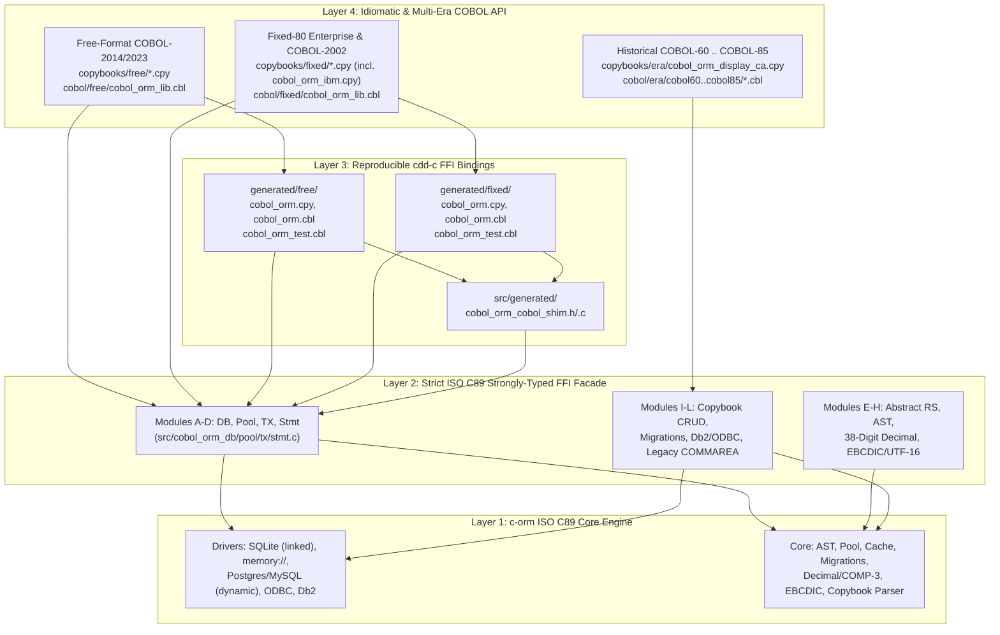
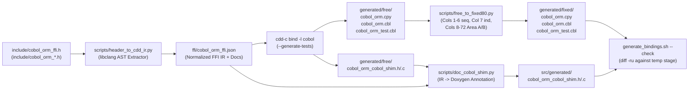
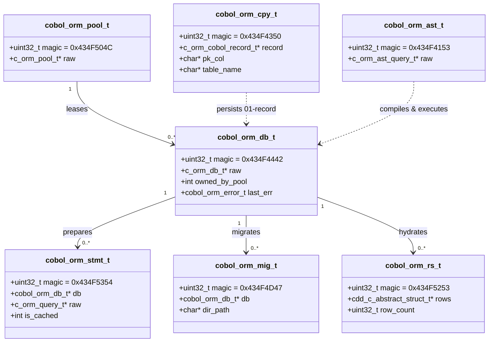
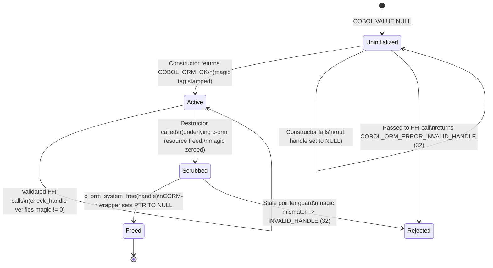
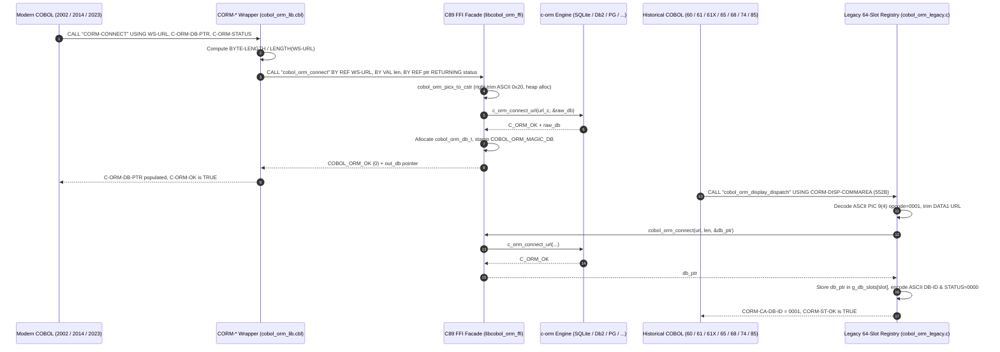
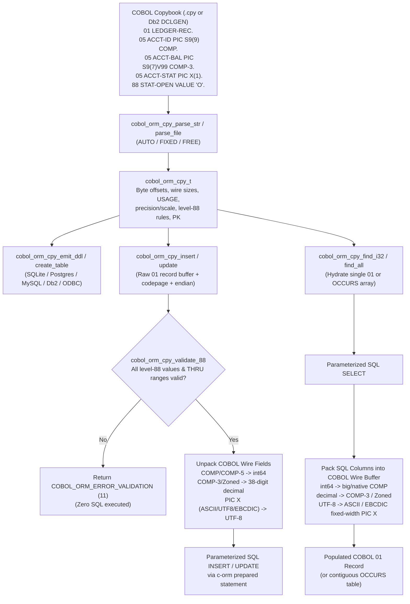
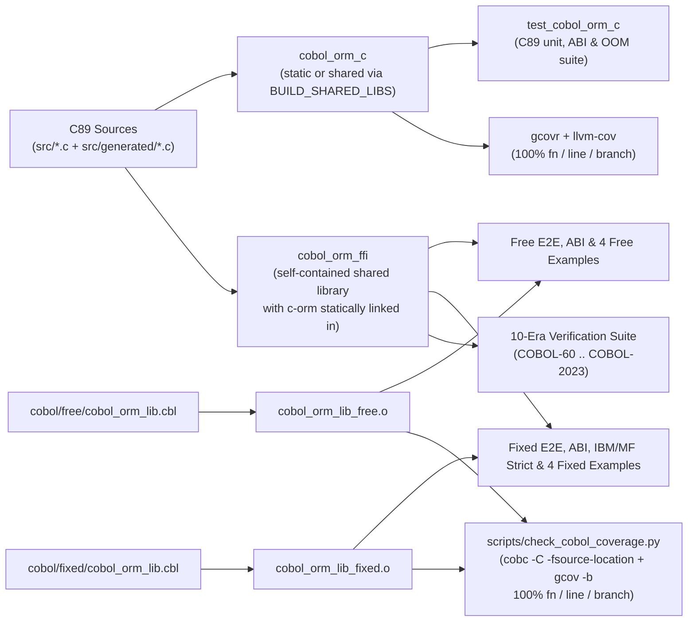

# `cobol-orm` Architecture

This document describes the complete layered architecture, Foreign Function Interface (FFI) generation pipeline, binary ABI contracts, memory ownership model, error percolation semantics, multi-era COBOL standard transport protocols (`COBOL-60` through `COBOL-2023`), and verification infrastructure of **`cobol-orm`**.

---

## 1. System Overview (4-Layer Architecture)

`cobol-orm` bridges the strict ISO C89 relational ORM engine ([`c-orm`](../c-orm)) to all ten historical and modern COBOL standards via a reproducible, zero-drift [`cdd-c`](../cdd-c) code generation pipeline and a strongly-typed C89 FFI facade.

### Architectural Separation of Concerns

| Layer | Location | Language / Standard | Primary Responsibility |
| :--- | :--- | :--- | :--- |
| **Layer 1** | `../c-orm` (or FetchContent) | ISO C89 (`-std=c90`) | Database drivers, SQL AST, migrations, 38-digit decimal math, EBCDIC tables, `.cpy`/DCLGEN parser |
| **Layer 2** | `include/`, `src/` | ISO C89 (`-std=c90 -pedantic -Werror`) | Distinct magic-tagged opaque handles, bounded `PIC X` marshaling, universal `cobol_orm_error_t` percolation, legacy 64-slot handle registry & COMMAREA dispatchers |
| **Layer 3** | `ffi/`, `generated/`, `src/generated/` | Normalized IR JSON, C89, Free & Fixed-80 COBOL | Machine-generated 1:1 COBOL Copybooks, subprogram stubs, ABI layout checks, and documented C89 ABI shims |
| **Layer 4** | `copybooks/`, `cobol/`, `examples/` | COBOL-60 .. COBOL-2023 (Free & Fixed-80) | Idiomatic `CORM-*` wrapper subprograms, level-`88` error/domain Copybooks, IBM Enterprise (`COMP-5`) Copybook, and 10-era compatibility suites |

---

## 2. Reproducible `cdd-c` Codegen & Drift-Check Pipeline

All FFI bindings are regenerated deterministically via [`scripts/generate_bindings.sh`](scripts/generate_bindings.sh) and verified byte-for-byte in pre-commit and CI (`--check` mode).

### Pipeline Invariants

1. **Lossless IR Extraction**: [`scripts/header_to_cdd_ir.py`](scripts/header_to_cdd_ir.py) uses `libclang` to preserve exact typedef widths, `const` qualifiers, pointer depths (`*`, `**`), fixed array bounds, enum integer values, and full Doxygen docblocks into [`ffi/cobol_orm_ffi.json`](ffi/cobol_orm_ffi.json).
2. **Doxygen-Complete Generated Shims**: [`scripts/doc_cobol_shim.py`](scripts/doc_cobol_shim.py) injects IR-sourced Doxygen comments into every struct, field, typedef, guard macro, and helper inside `src/generated/cobol_orm_cobol_shim.h` so `Doxyfile.in` enforces 100% documentation coverage with **zero exclusions** (`WARN_AS_ERROR = YES`).
3. **Strict Fixed-80 Emission**: [`scripts/free_to_fixed80.py`](scripts/free_to_fixed80.py) transforms free-format COBOL into strict punched-card 80-column fixed format (columns 1–6 blank sequence area, column 7 `*` comment or `-` continuation indicator, Area A columns 8–11, Area B columns 12–72, zero `>>SOURCE FORMAT` or `*>` free-format tokens) and verifies all fixed files in `--verify` mode.
4. **Zero-Drift Enforcement**: Running `./scripts/generate_bindings.sh --check` stages a fresh build in a temporary directory and runs `diff -ru` across `ffi/`, `generated/free/`, `generated/fixed/`, and `src/generated/`. Any uncommitted drift fails the gate immediately.

---

## 3. Strong Typing, Opaque Handles & ABI Layout Contracts

### 3.1 Distinct Magic-Tagged Opaque Handle Hierarchy

`cobol-orm` forbids raw `void *` handle aliasing across C boundaries. Every resource type is a distinct incomplete `struct` in [`include/cobol_orm_types.h`](include/cobol_orm_types.h) backed by a unique 32-bit magic tag validated on every FFI entry point and zero-scrubbed upon destruction.

### 3.2 Handle Lifecycle State Machine

### 3.3 Exact-Size ABI POD Structures

All five value-type structs crossing the C89 <-> COBOL boundary are layout-locked and asserted at runtime on **both** C (`sizeof` / `offsetof` in `tests/c/test_cobol_orm.c`) and COBOL (`FUNCTION BYTE-LENGTH` in `generated/free/cobol_orm_test.cbl` and `generated/fixed/cobol_orm_test.cbl`):

| C89 Struct (`include/cobol_orm_types.h`) | COBOL Record (`copybooks/*/cobol_orm_types.cpy` & `cobol_orm_ibm.cpy`) | Exact Size | Purpose |
| :--- | :--- | ---: | :--- |
| `cobol_orm_decimal_t` | `C-ORM-DECIMAL-REC` | **41 bytes** | Lossless 38-digit base-10 fixed-point decimal (1:1 with `c_orm_decimal_t`) |
| `cobol_orm_pool_stats_t` | `C-ORM-POOL-STATS-REC` | **24 bytes** | Pool active/idle counts, exhaustion count, slow query count, average wait ms (`double`/`FLOAT-LONG`/`COMP-2`) |
| `cobol_orm_cpy_info_t` | `C-ORM-CPY-INFO-REC` | **12 bytes** | Parsed Copybook wire byte size, mapped field count, DCLGEN indicator |
| `cobol_orm_col_info_t` | `C-ORM-COL-INFO-REC` | **16 bytes** | Single field byte offset, wire size, `USAGE`, total digits, scale, signed flag, PK flag |
| `cobol_orm_commarea_t` | `C-ORM-COMMAREA-REC` | **544 bytes** | Native-binary single-argument COMMAREA request/response block |
| Pure `USAGE DISPLAY` buffer | `CORM-DISP-COMMAREA` (`copybooks/era/cobol_orm_display_ca.cpy`) | **552 bytes** | Endian-independent pure ASCII `PIC 9`/`PIC X` COMMAREA for `COBOL-60`..`COBOL-85` |

---

## 4. Dual Transport Protocols: Modern Pointer ABI vs. Legacy `COMMAREA`

Because COBOL spans over 65 years of ISO/ANSI standards, `cobol-orm` provides two first-class call transports over the exact same C89 FFI implementation:

### Why Two Transports?

1. **COBOL-2002 / COBOL-2014 / COBOL-2023 / IBM Enterprise / Micro Focus**:
   - Have native `USAGE POINTER`, `BY VALUE`, `RETURNING`, and fixed-width binary types (`USAGE BINARY-LONG` in ISO 2002+, or `PIC S9(9) COMP-5` in strict IBM Enterprise / Micro Focus).
   - Call either the idiomatic short-named [`cobol/{free,fixed}/cobol_orm_lib.cbl`](cobol/free/cobol_orm_lib.cbl) wrappers (`CORM-*`) or the full 87-function `cdd-c` surface (`cobol_orm_*` / `COBOL-ORM-*`).
2. **COBOL-60 / COBOL-61 / COBOL-61 Extended / COBOL-65 / COBOL-68 / COBOL-74 / COBOL-85**:
   - Lack `USAGE POINTER`, `BY VALUE`, `RETURNING`, and uniform `COMP` byte order across big-endian mainframes and little-endian ARM64/x86-64 hosts.
   - Invoke `CALL "cobol_orm_display_dispatch" USING CORM-DISP-COMMAREA` with a single `BY REFERENCE` 552-byte pure `USAGE DISPLAY` ASCII block ([`copybooks/era/cobol_orm_display_ca.cpy`](copybooks/era/cobol_orm_display_ca.cpy)).
   - Integer slot IDs (`0001`–`0064`) index into the 64-slot database and 64-slot statement registry in [`src/cobol_orm_legacy.c`](src/cobol_orm_legacy.c), completely immune to pointer width (32-bit vs 64-bit) and CPU endianness.

---

## 5. Copybook-Driven `01`-Record CRUD Architecture

One of `cobol-orm`'s flagship capabilities is persisting and hydrating raw COBOL `01` Working-Storage records directly without writing manual field-by-field marshaling code.

---

## 6. String, Binary, Decimal & Codepage Marshaling

| COBOL Representation | C89 FFI Marshal Strategy | Overflow / Failure Semantics |
| :--- | :--- | :--- |
| Input `PIC X(N)` (URLs, SQL, DDL, identifiers) | `cobol_orm_picx_to_cstr()` right-trims trailing ASCII spaces (`0x20`) and allocates exact `len + 1` bytes via `c_orm_system_malloc` (no 256-byte cap, no stack VLAs) | `COBOL_ORM_ERROR_NULL_POINTER` (14) or `COBOL_ORM_ERROR_MEMORY` (1) |
| Output `PIC X(N)` (error text, column text, SQL, version) | `cobol_orm_cstr_to_picx()` copies up to `buf_cap` bytes, right-pads remaining bytes with `0x20`, writes exact unpadded source length to `*out_len` | Returns `COBOL_ORM_ERROR_TRUNCATION` (26) if source exceeds `buf_cap` while still reporting required length in `*out_len` |
| Binary `BLOB` / `COMP-3` / `EBCDIC` | `cobol_orm_bytes_copy()` exact byte copy with explicit `(buf, len)` / `(out_buf, cap, out_len)` | `COBOL_ORM_ERROR_TRUNCATION` (26) or `COBOL_ORM_ERROR_BUFFER_TOO_SMALL` (33) |
| 38-Digit Fixed-Point Decimal | Stack-allocated 41-byte `cobol_orm_decimal_t` (zero floating-point loss), 4 rounding modes (`TRUNCATE`, `HALF_UP`, `HALF_EVEN`, `ERROR_IF_INEXACT`) | `DECIMAL_SYNTAX` (27), `DECIMAL_OVERFLOW` (28), `DECIMAL_INEXACT` (29) |
| Mainframe EBCDIC & UTF-16 `GRAPHIC` | Codepage tables for `IBM037`, `IBM1047`, `IBM500`, `IBM1140` (Euro `U+20AC`), plus big/little-endian UTF-16 with unpaired surrogate rejection | `COBOL_ORM_ERROR_CODEPAGE` (30) |

---

## 7. Universal Error Percolation & Memory / OOM Guarantees

### Universal `cobol_orm_error_t` Discipline

- **Every** C89 function in `include/` and `src/` returns `cobol_orm_error_t` annotated with `COBOL_ORM_NO_DISCARD`, statically verified by [`scripts/check_enum_returns_clang.py`](scripts/check_enum_returns_clang.py).
- **Zero `(void)` return discards**: Statically verified by [`scripts/check_no_discard_void_clang.py`](scripts/check_no_discard_void_clang.py).
- **Primary-Error Preservation**: Cleanup calls combine return codes via `cobol_orm_keep_err(primary, cleanup)` so teardown errors are neither silently discarded nor allowed to overwrite an earlier failure code.
- **1:1 `c-orm` Error Parity**: Codes `0..31` mirror `c_orm_error_t` identically; codes `32..36` cover FFI handle/buffer/legacy-dispatch conditions. Every code maps to an explicit COBOL level-`88` predicate (`C-ORM-OK` through `C-ORM-ERR-INV-OP`).

### Deterministic OOM & Sanitizer Safety

- All dynamic allocations route through `c_orm_system_malloc`, `c_orm_system_calloc`, and `c_orm_system_free`.
- [`tests/c/test_cobol_orm.c`](tests/c/test_cobol_orm.c) injects deterministic allocation failures via `c_orm_set_allocators` across every allocation-bearing API path to exercise 100% of cleanup unwind branches with zero leaks.
- Every build configuration is verified clean under `-fsanitize=address,undefined` (`-DCOBOL_ORM_ENABLE_ASAN=ON`) and Linux Valgrind in CI.

---

## 8. Multi-Dialect CMake Build & Quality-Gate Architecture

### Build Encapsulation & Distribution

- **`c-orm` Consumption**: Automatically consumes a local sibling `../c-orm` checkout when present, falling back transparently to `FetchContent` (`https://github.com/SamuelMarks/c-orm.git`) for standalone builds.
- **Self-Contained Shared Artifacts**: `BUILD_SHARED_LIBS` is temporarily held `OFF` while fetching `c-orm` so `libcobol_orm` (when built shared) and `libcobol_orm_ffi` embed `c-orm` cleanly with no broken runtime export dependencies, enabling clean `install(EXPORT cobol-orm-targets ...)` + `cobol-orm-config.cmake` + `cobol-orm.pc`.
- **Zero Warning Suppressions**: Compiled with `-std=c90 -pedantic -Wall -Wextra -Werror -Wdeclaration-after-statement -Wmissing-prototypes -Wstrict-prototypes -Wold-style-definition -Wwrite-strings -Wcast-qual` (GCC/Clang) or `/W4 /WX /sdl` (MSVC), and `cobc -Wall -Wextra -Werror` (including `-std=ibm-strict`, `-std=mf-strict`, `-std=cobol85`, `-std=cobol2002`, and `-std=cobol2014`).
